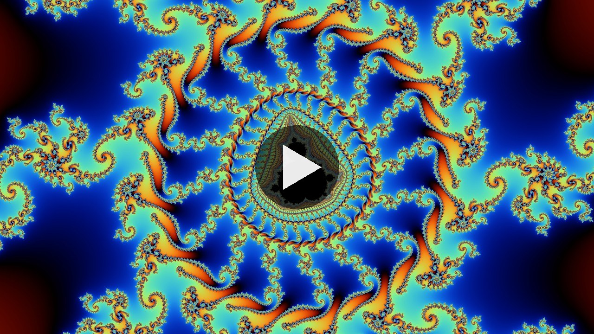
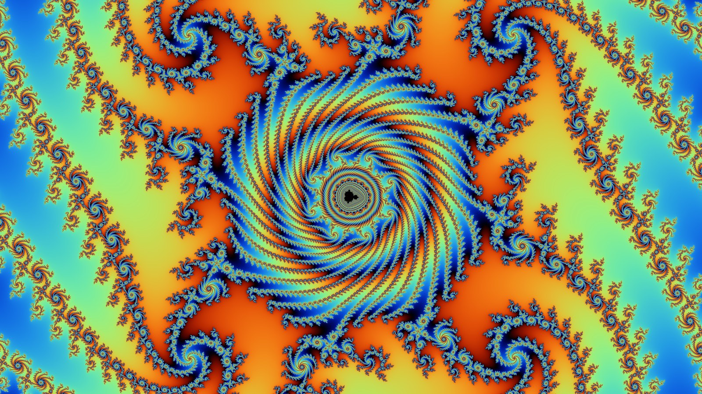

# Mandelbrot by Jort

A Mandelbrot set viewer written in Rust, with a graphical window: explore the set, fly to named places, and save images and videos. The same view and settings always render exactly the same image.

- **Fast**: every CPU thread but one with the CPU's vector instructions, and the GPU next to them; a progressive render that shows every layer as soon as it is done.
- **Smooth**: smooth coloring, supersampling up to 64 samples per pixel (adaptive, where the picture has detail), and a color cycle as in Kalles Fraktaler.
- **Flights** to named places, with frame rates up to the screen's, and **videos** of them, rendered offline.
- **Automatic iterations** that follow the zoom, or your own limit.

[](https://www.youtube.com/watch?v=xBHr8kl_cEg)



More in the [gallery](docs/GALLERY.md).

```
   __             __         __      .---.
  / /  __ __  __ / /__  ____/ /_    [ o o ]   and his robotic friends:
 / _ \/ // / / // / _ \/ __/ __/     '-v-'    Claude Code, beep boop
/_.__/\_, /  \___/\___/_/  \__/       /|_|\
     /___/
                                 v0.4.0
```

## Quick start
Install Rust ([rustup.rs](https://www.rust-lang.org/tools/install)), for example on Linux:
```
curl --proto '=https' --tlsv1.2 -sSf https://sh.rustup.rs | sh
```
Then, in the root of the repository:
```
cargo run --release
```
There are no command-line arguments: everything is in the window. Videos need [`ffmpeg`](https://ffmpeg.org) on the path (without it you can still save their frames as PNG files).

## Using it
The fractal is on the left; on the right are the controls, in sections that open and close with a click on their title. Hover over a control to see what it does.

- **Mouse**: drag the fractal to move, scroll to zoom around the cursor, click to see the coordinates of a point, right-click to center on it.
- **Places**: pick one in the list to fly there, or use *Save this view...* to add your own. They are the `.json` files of the [`points_of_interest`](points_of_interest) folder; see [the place files](docs/POINTS_OF_INTEREST.md).
- **Saving**: images (PNG, with the view and the settings in their metadata) and videos go to `saved/`, benchmark runs to `benchmarks/`.
- **Settings** are remembered in `mandelbrot/settings.json` in your configuration folder (`~/.config` on Linux, `%APPDATA%` on Windows); *Reset settings* puts them back.

## Documentation
- [Development](docs/DEVELOPMENT.md): how an image is made, the tests, the benchmarks and the modules.
- [Place files](docs/POINTS_OF_INTEREST.md): the format of the points of interest.
- [Sources](SOURCES.md): the articles and references behind the renderer.

## Credits
- By Jort (jortrr).
- With the help of Claude Code (Anthropic): a large part of the code, the tests and the documentation since version 0.2.0 was written with it, as the commit messages say.
- Licensed under the GNU General Public License, version 3 or later: see [LICENSE](LICENSE) and [NOTICE](NOTICE).
